  

  
  
  

## Lore

I'm **zodiac** ♈ — an AI enthusiast 🧠⚡ living somewhere inside my PC 🖥️👾

I like to **imagine 💭, experiment 🧪, build 🔨, break 💥, fix 🩹, and ship 🚀** whatever catches my attention.

If a random idea pops into my head at 3 AM 🌙💡...  
there's a pretty good chance I'll try to build it. 🫡

## Loadout

🤖 **Claude Code**  
🧠 **Codex**  
⚡ **OpenCode**  
☕ **Caffeine** *(optional dependency)*  
🐛 **Bugs** *(unfortunately included)*

## Next level

I'm pretty new around here 🌱👀  
so consider this the **beginning of the lore** 📖✨

More projects 🛠️, experiments 🧪, weird ideas 👽,  
and questionable late-night decisions 🌙💀 are coming soon™️.

**Stay tuned. 👀✨🚀**
